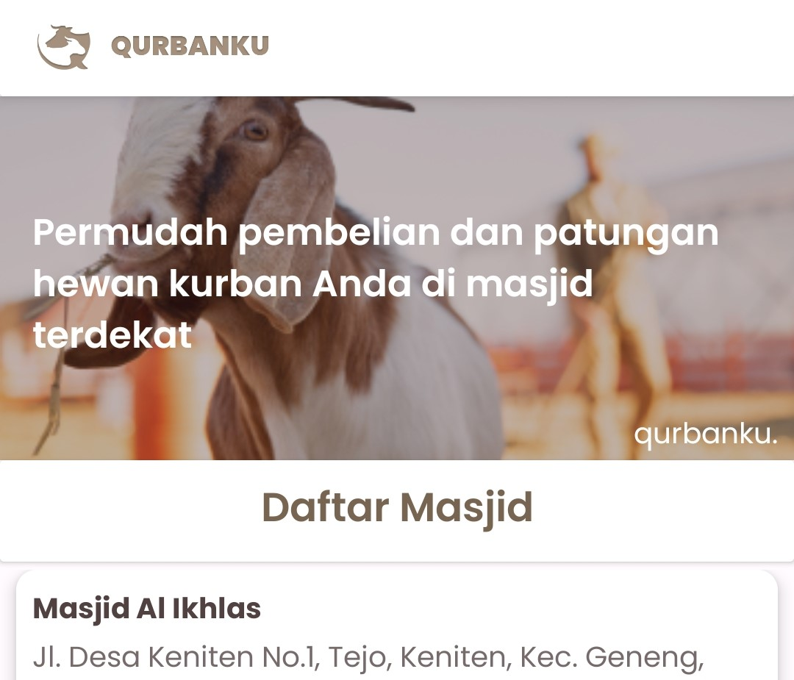
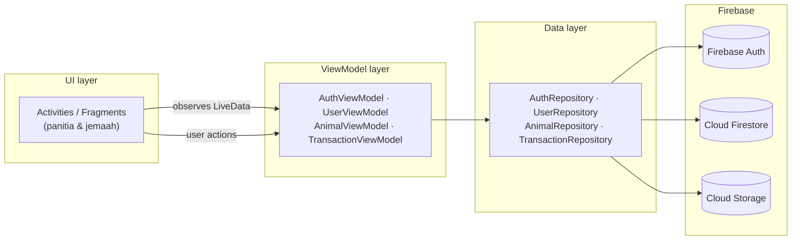

<p align="center">
  
</p>

<h1 align="center">Qurbanku</h1>

<p align="center">
  An Android app that helps a mosque's qurbani committee and its congregation
  organize and jointly fund qurbani animals.<br />
  Built as an undergraduate thesis project for the qurbani committee at Masjid Al Huda, Malang.
</p>

<p align="center">
  <a href="https://youtu.be/70XUhdvDiKU"><b>▶ Watch the demo</b></a>
</p>

<p align="center">
  
</p>

---

## Why

Every Eid al-Adha, mosque committees collect money for shared qurbani animals
(one cow is usually split between seven people). That process mostly happens
through chat groups, paper lists, and manually checked bank transfers.
Qurbanku moves it into one app: the committee publishes animals, congregants
join a share and send proof of payment, and the committee verifies payments
and reports when each animal has been slaughtered.

## Features

The app has two roles, each with its own sign-up flow and home screen.

### Committee (panitia)
- **Register a mosque** with its address, bank account, and location picked on a map.
- **Publish qurbani animals** with species, variety, weight, colour, price, operational
  costs, number of shares, and a photo taken with the in-app camera.
- **Manage participants (shohibul qurbani)** for each animal.
- **Review transactions**: see the uploaded proof of transfer, then accept or reject it
  with a note.
- **Mark an animal as slaughtered**, so participants can see its status.

### Congregant (jemaah)
- **Find a mosque** from a list or on a map, using the device location.
- **Browse a mosque's animals** and see the cost per share (price plus operational costs) and how many shares are left.
- **Join an animal** by uploading proof of transfer, either from the camera or the gallery.
- **Track transactions** (waiting, accepted, rejected) and view qurbani history.

## Tech stack

| Area | Libraries |
|---|---|
| Language | Kotlin |
| UI | XML layouts, ViewBinding, Material Components, Navigation Component |
| Architecture | MVVM with ViewModel + LiveData, repository layer |
| Backend | Firebase Authentication (email/password), Cloud Firestore, Cloud Storage |
| Camera | CameraX (camera2, lifecycle, view) |
| Location | Google Maps SDK, Fused Location Provider |
| Images | Glide, CircleImageView |

## Architecture



Each screen talks only to its ViewModel. ViewModels expose `LiveData` and call
repositories, and the repositories are the only classes that use the Firebase SDKs.

### Firestore collections

| Collection | Holds |
|---|---|
| `user` | Both roles. Committee accounts (`admin = true`) also store the mosque address, location, and bank details. |
| `animal` | Animals published by a mosque (`idMasjid`), with price, shares, status, and the list of participants. |
| `transaction` | A congregant's payment for an animal: proof photo URL, status, and the committee's note. |

### Project structure

```
app/src/main/java/com/androidexpert/qurbanku_apps_skripsi/
├── data/
│   ├── lib/        # Data classes: User, Animal, Transaction
│   └── remote/     # Repositories that wrap Firebase Auth, Firestore, and Storage
├── adapter/        # RecyclerView adapters (animal, transaction, user)
├── ui/
│   ├── welcome/    # Splash and welcome screens
│   ├── auth/       # Login and role-based sign-up
│   ├── main/       # Main screen with bottom navigation for each role
│   ├── home/       # Home screens for each role
│   ├── animal/     # Publish, list, and view animals
│   ├── transaction/# Join an animal, review and confirm payments
│   ├── maps/       # Mosque map, pick and update location
│   ├── profile/    # Profiles for mosques and congregants
│   ├── CameraActivity.kt
│   └── ViewModelFactory.kt
└── utils/          # Helpers, money formatting, preferences
```

## Getting started

### Requirements
- Android Studio (Hedgehog or newer) with JDK 17
- An Android device or emulator running Android 5.0 (API 21) or higher
- Your own Firebase project and Google Maps API key

### Setup
1. **Clone the repository**
   ```bash
   git clone https://github.com/rezaagung1101/QURBANKU_APPS_SKRIPSI.git
   ```
2. **Connect Firebase**
   - Create a Firebase project and add an Android app with the package name
     `com.androidexpert.qurbanku_apps_skripsi`.
   - Enable **Email/Password** sign-in, **Cloud Firestore**, and **Cloud Storage**.
   - Download `google-services.json` and replace `app/google-services.json`.
3. **Add a Google Maps API key**
   - Create a key with the **Maps SDK for Android** enabled, restricted to this package
     name and your signing certificate's SHA-1.
   - Put it in your user-level Gradle properties (`~/.gradle/gradle.properties`) so it
     never ends up in Git. It takes precedence over the project's `gradle.properties`:
     ```properties
     API_KEY=your_maps_api_key
     ```
4. **Run** the `app` configuration from Android Studio.

## Author

**Reza Agung Nugraha**, Android Developer

- Portfolio: [rezaagung1101.github.io](https://rezaagung1101.github.io)
- LinkedIn: [linkedin.com/in/rezaagn2](https://www.linkedin.com/in/rezaagn2/)
- GitHub: [@rezaagung1101](https://github.com/rezaagung1101)
